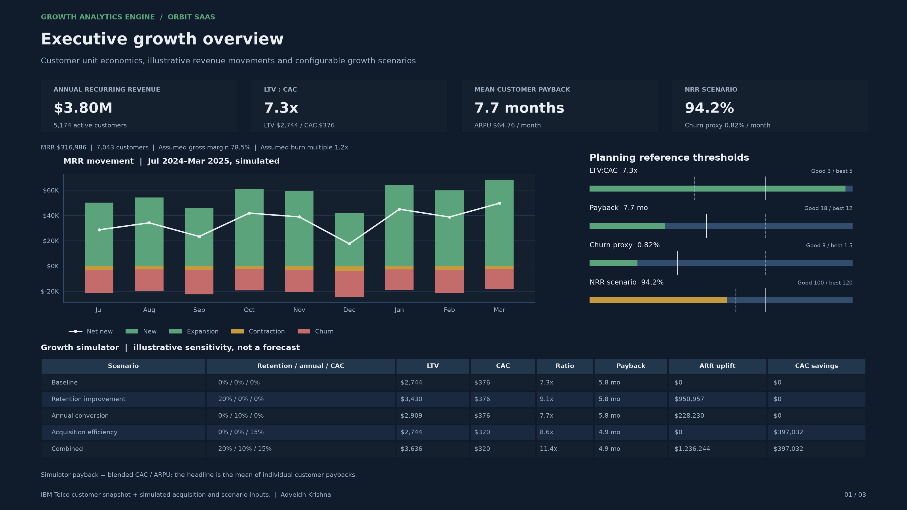
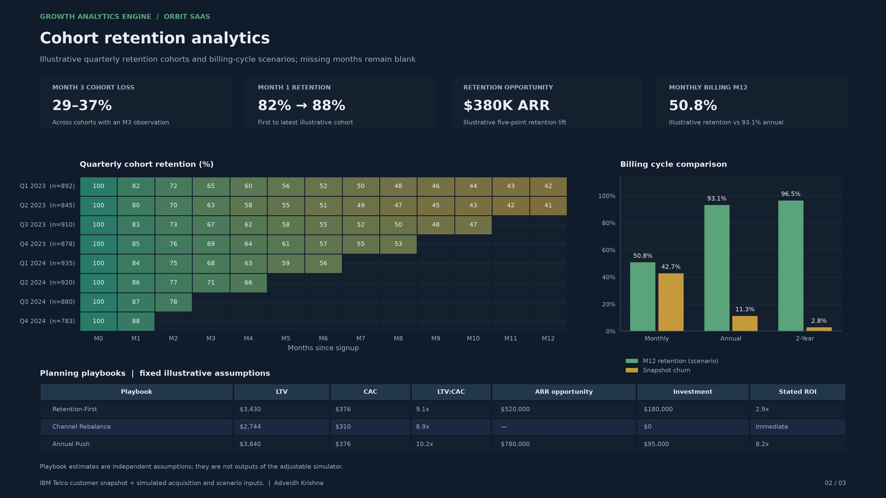
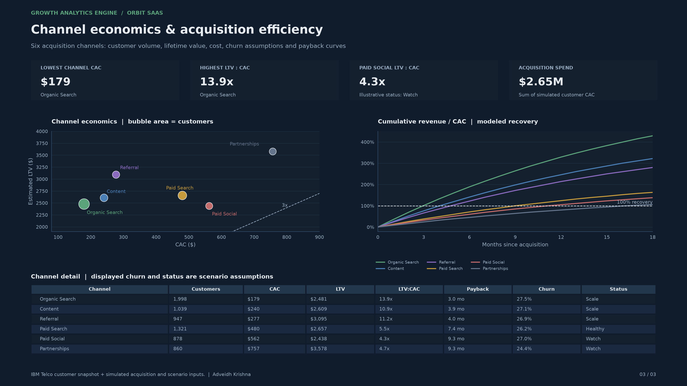

# Growth-Analytics-Engine

Customer lifetime value, acquisition efficiency and retention planning for **Orbit**, a fictional B2B subscription business. Python, pandas, matplotlib and seaborn turn a customer snapshot and explicit scenario inputs into three reproducible executive dashboards.

[Project repository](https://github.com/AKJ7320/Growth-Analytics-Engine)

## Business questions

- Which acquisition channels return the most lifetime revenue per dollar spent?
- Where do retention and billing-cycle assumptions expose growth opportunities?
- How do retention, annual conversion and CAC reductions change planning outcomes?

The customer model produces **$3.80M ARR**, **7.3x blended LTV:CAC**, **7.7 months mean customer payback**, and **7,043 customers**. Organic Search has a 13.9x ratio; Paid Social has a 4.3x ratio. These are modeled case-study results, not operating results of a real company.

## Data and assumptions

| Input | Use | Status |
|---|---|---|
| `data/raw/telco_churn.csv` | Subscription charges, tenure and churn | IBM Telco Customer Churn snapshot |
| `data/processed/orbit_saas_customers.csv` | Customer and channel economics | Enriched snapshot with simulated CAC, channels and signup dates |
| `data/processed/dashboard_inputs.json` | Quarterly cohorts, monthly movements, NRR, planning thresholds and playbooks | Explicit illustrative assumptions |
| `data/processed/dashboard_metrics.json` | Dashboard metrics and selected scenario | Recomputed by the dashboard script |
| Other processed JSON files | Segment analysis, LTV distributions and allocation research | Produced by `model/` scripts |

The monthly revenue scenario covers July 2024–March 2025. Retention scenarios cover 2023–2024 cohorts; derived customer signup dates precede 2026. NRR, gross margin and burn multiple are assumptions, not measured cash-flow or event-history statistics. The model estimates revenue LTV without a gross-margin adjustment. See [the metric catalog](docs/dashboard_notes.md) for formulas and limitations.

# Dashboard Screenshots

### Executive growth overview

ARR, LTV:CAC, payback and NRR cards; monthly revenue movements, planning thresholds and a configurable growth simulator.



### Cohort retention analytics

Quarterly retention heatmap, billing-cycle comparisons and three illustrative investment playbooks.



### Channel unit economics

Acquisition cost versus lifetime value, customer-weighted bubbles, modeled recovery curves and channel details.



All three images are 3200 × 1800 pixels (16:9), rendered at 200 DPI. The [static gallery](docs/index.html) also displays them.

## Run locally

Python 3.10 or newer is required. From the repository root:

```bash
python -m pip install -r requirements.txt
python dashboard/generate_dashboards.py
python -m unittest discover -s tests -v
```

Adjust the simulator without editing source files:

```bash
python dashboard/generate_dashboards.py --retention 20 --annual 10 --cac-reduction 15
```

Levers are percentages: retention improvement 0–40, annual conversion 0–50 and CAC reduction 0–30. The default PNGs use 20/10/15. Outputs overwrite `screenshots/` and the dashboard metrics report. `--output-dir` changes only the image output directory.

To rebuild the customer model and its supporting analyses:

```bash
python model/prepare_data.py
python model/cohort_analysis.py
python model/ltv_model.py
python model/unit_economics.py
python dashboard/generate_dashboards.py
```

The simulator is a sensitivity model, not a causal forecast. Its payback is blended CAC divided by ARPU (5.8 months at baseline), while the headline 7.7 months is the mean of individual customer paybacks. CAC savings use the sum of customer acquisition costs. Fixed playbook and reallocation targets remain separate assumptions.

## Repository structure

```text
Growth-Analytics-Engine/
├── dashboard/
│   ├── generate_dashboards.py
│   └── theme.json                # Presentation settings
├── data/
│   ├── raw/telco_churn.csv
│   └── processed/                 # Customer data, scenario inputs and reports
├── model/
│   ├── prepare_data.py
│   ├── cohort_analysis.py
│   ├── ltv_model.py
│   └── unit_economics.py
├── screenshots/
│   ├── executive_growth_overview.png
│   ├── cohort_retention_analytics.png
│   └── channel_unit_economics.png
├── docs/
│   ├── dashboard_notes.md
│   └── index.html
├── tests/test_dashboard_metrics.py
├── PROJECT_BRIEFING.md
└── requirements.txt
```

# Author

Adveidh Krishna

Financial Analyst

[LinkedIn](https://www.linkedin.com/in/akthotarath)
